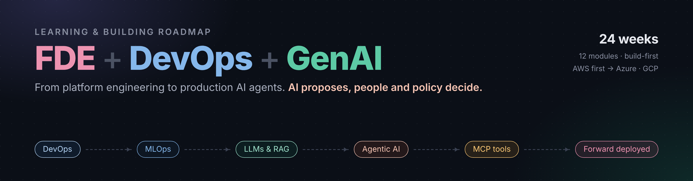
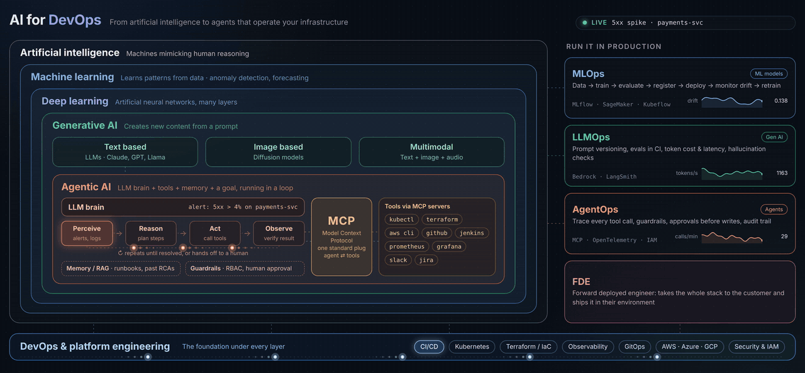

  

# FDE + DevOps + GenAI Roadmap

A learning-and-building roadmap for becoming a **Forward Deployed Engineer (FDE)** with a strong DevOps/platform base and applied GenAI/agent skills. Every course module is paired with something you build, so the repo doubles as a portfolio.

- Course followed: Psitron *Gen AI & Agentic AI Specialization* (12 modules)
- Start: 9 Nov 2026 · Target: 24 weeks (late Apr 2027)
- Cloud bias: AWS first (Bedrock, ECR, CodeBuild, EKS/kOps), then compare Azure and GCP
- Principle: **AI proposes, people and policy decide.** Read-only first, approvals before changes.

## The big picture

Click the diagram to open the full-resolution still.

An animated version lives in [docs/aiops](docs/aiops/README.md).

## How this repo works
| Path | What it holds |
|---|---|
| [ROADMAP.md](ROADMAP.md) | 24-week plan: module -> build -> proof |
| [docs/skill-ladder.md](docs/skill-ladder.md) | Zero-to-advanced DevOps ladder with self-check |
| [docs/aiops/](docs/aiops/README.md) | AIOps map: live animated diagram, terminology, and how it ties to the projects |
| [docs/fde-skills.md](docs/fde-skills.md) | Customer-facing FDE skills and a 2-week POC playbook |
| [docs/interview-prep.md](docs/interview-prep.md) | FDE interview areas and practice prompts |
| [PROGRESS.md](PROGRESS.md) | Checklist you tick as you go |
| [projects/](projects/) | One folder per build project (add new ones freely) |
| [templates/](templates/) | Project README and weekly-log templates |

## Adding a project
Copy `templates/project-template.md` into `projects/NN-name/README.md`, fill it in, add a row to the table below and tick it in PROGRESS.md.

## Projects
| # | Project | Course modules | Status |
|---|---|---|---|
| 00 | CloudOps prompt-engineering skill | 2 | done |
| 01 | Ops prompt library + eval harness | 1, 2 | planned |
| 02 | Bedrock incident-triage CLI | 3, 4 | planned |
| 03 | Runbook RAG assistant (MJ's Cart docs) | 5 | planned |
| 04 | Prompt vs RAG vs fine-tune memo | 6, 7 | planned |
| 05 | Ops agent with human approval (LangGraph + MCP) | 8 | planned |
| 06 | Evals, tracing and guardrails | 9, 10 | planned |
| 07 | Production deployment: Docker, K8s, CI/CD, LLMOps | 11, 12 | planned |
| 08 | **Capstone**: MJ's Cart AI Ops Copilot | all | planned |
| 09 | Anomaly detection and alert correlation (classic AIOps baseline, optional) | 12 | planned |

## Safety
Never commit secrets, sensitive account IDs, or customer data. Use git-ignored `.env` files and short-lived credentials.

## License
MIT for code, CC BY 4.0 for written content.
