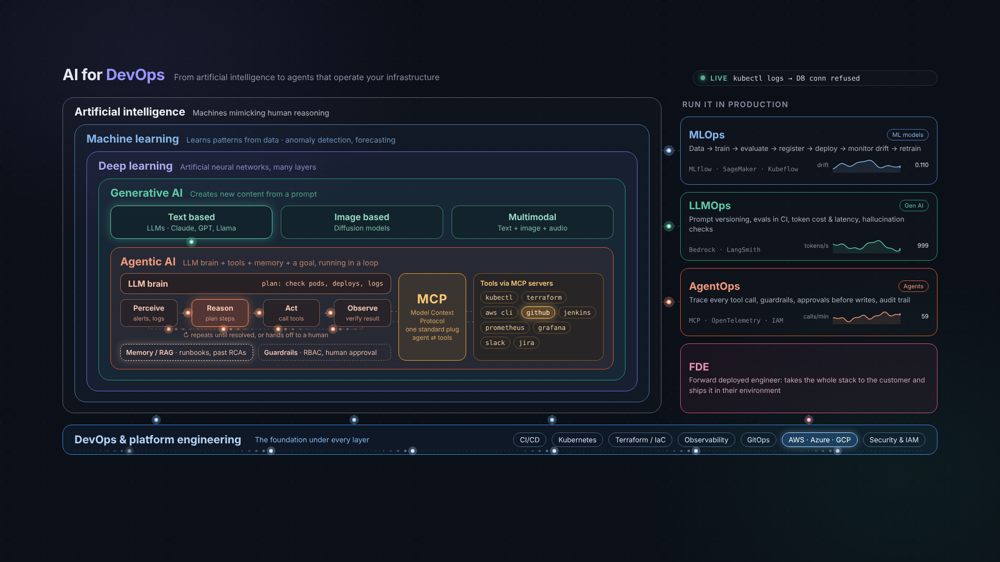

# AIOps map

[`ai-for-devops-live-wallpaper.html`](ai-for-devops-live-wallpaper.html) is a single self-contained, animated diagram (no external scripts or fonts). It shows how AI, machine learning, deep learning, generative AI and agents nest inside each other, how MCP connects an agent to tools, how AI systems are run in production, and where DevOps and the FDE role sit.

## View it live
- **Locally:** download the file and open it in a browser. It scales to any screen size.
- **On GitHub Pages:** in the repo go to Settings > Pages, choose *Deploy from a branch*, branch `main`, folder `/docs`. After a minute it is served at
  `https://jeevanm84.github.io/fde-devops-ai-roadmap/aiops/ai-for-devops-live-wallpaper.html`
- **As a desktop wallpaper:** a webpage-as-wallpaper app can display it (for example Plash on macOS, Lively Wallpaper on Windows) using the local file or the Pages URL.

## Two directions of "Ops" and "AI"
The diagram mixes two ideas that are easy to confuse. Keeping them apart makes interviews and design discussions clearer.

| Direction | Meaning | In the diagram | In this roadmap |
|---|---|---|---|
| **AIOps** (AI *for* operations) | Using ML, LLMs and agents to run infrastructure: anomaly detection, alert correlation, root-cause analysis, forecasting, auto-remediation | The nested stack on the left, with the DevOps foundation under it | Projects 02, 03, 05, 08, 09 |
| **MLOps / LLMOps / AgentOps** (Ops *for* AI) | Running AI systems reliably: drift monitoring, prompt versioning, evals in CI, tracing tool calls, approvals, cost | The "Run it in production" column on the right | Projects 06, 07 |

A strong FDE can do both: build the AI that helps a customer's operations team, then run that AI safely in the customer's environment.

## Diagram layers mapped to the roadmap
| Layer in the diagram | What it means for ops work | Course module | Project |
|---|---|---|---|
| Machine learning | Anomaly detection on metrics, forecasting, alert noise reduction | 12 (MLOps) | 09 |
| Generative AI, text | Summarize logs, explain errors, draft runbooks and postmortems | 1, 2, 3, 4 | 01, 02 |
| Memory / RAG | Ground answers in runbooks and past RCAs | 5 | 03 |
| Agentic AI loop | Perceive, reason, act, observe, repeat until resolved or handed off | 8 | 05 |
| MCP and tools | One standard way for an agent to call kubectl, Terraform, AWS, Prometheus | 8 | 05 |
| Guardrails | RBAC, least privilege, human approval before writes | 10 | 05, 06 |
| LLMOps | Evals, prompt versions, token cost and latency | 9 | 06 |
| AgentOps | Trace every tool call, audit trail | 9, 10, 11 | 06, 07 |
| DevOps foundation | CI/CD, Kubernetes, IaC, observability, GitOps | 11 | 07, 08 |
| FDE | Ship it in the customer's environment | all | 08 |

## Trust levels for AIOps automation
Move up one level at a time, and only after the level below has proven reliable on real cases.

1. **Observe:** the system summarizes and explains. It changes nothing.
2. **Recommend:** it proposes ranked causes and next steps, each marked read-only or change.
3. **Act with approval:** it prepares a change (a pull request or a command) and waits for a human to approve.
4. **Act autonomously:** limited to a narrow, well-tested action with a rollback, a call budget and an audit log.

## Gap this roadmap fills
The course is strong on generative AI and agents but does not cover classic AIOps: anomaly detection, event correlation and forecasting on metrics. Those techniques are cheaper, faster and more predictable than an LLM for many alert problems. [Project 09](../../projects/09-anomaly-detection-alert-correlation/README.md) builds that baseline so you can show when an LLM adds value and when it does not.

## Using the diagram when presenting
Suggested 3-minute walk-through for an interview or customer call:
1. Start at the outer ring: AI is the umbrella, ML finds patterns in operational data.
2. Move inward to generative AI: LLMs read logs, tickets and docs.
3. Land on the agent loop: it acts through MCP tools, with memory and guardrails.
4. Point to the right column: this is how it stays reliable in production.
5. Finish at the bottom bar and FDE: none of it works without solid DevOps and delivery into the customer's environment.
